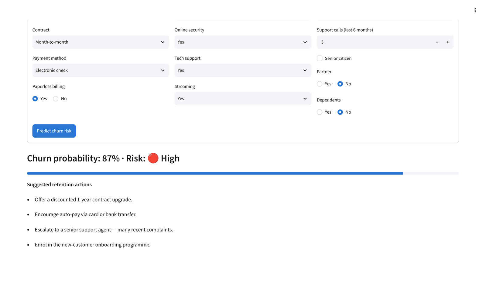
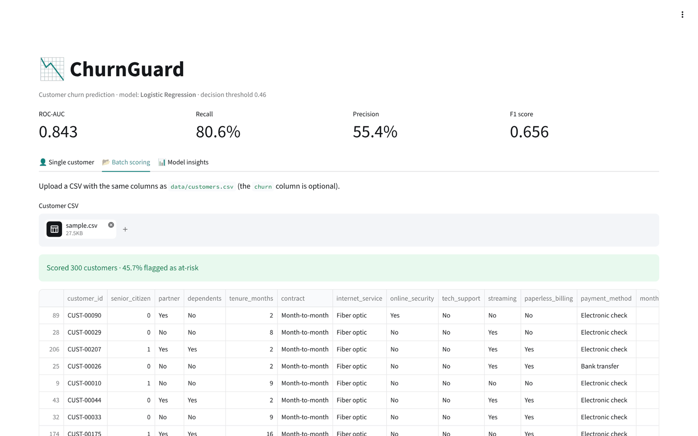
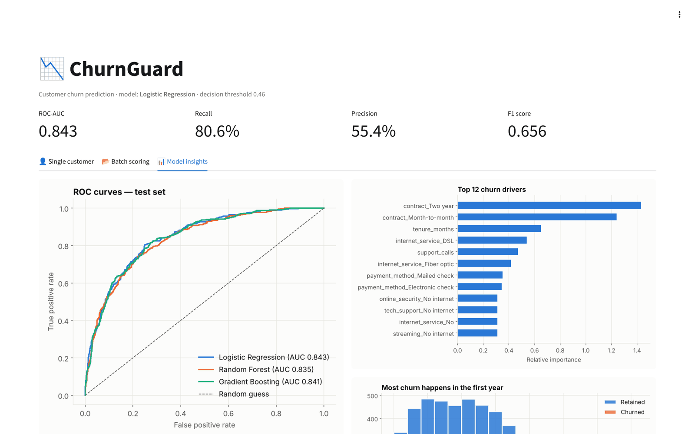
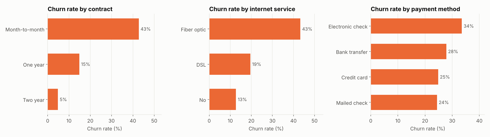
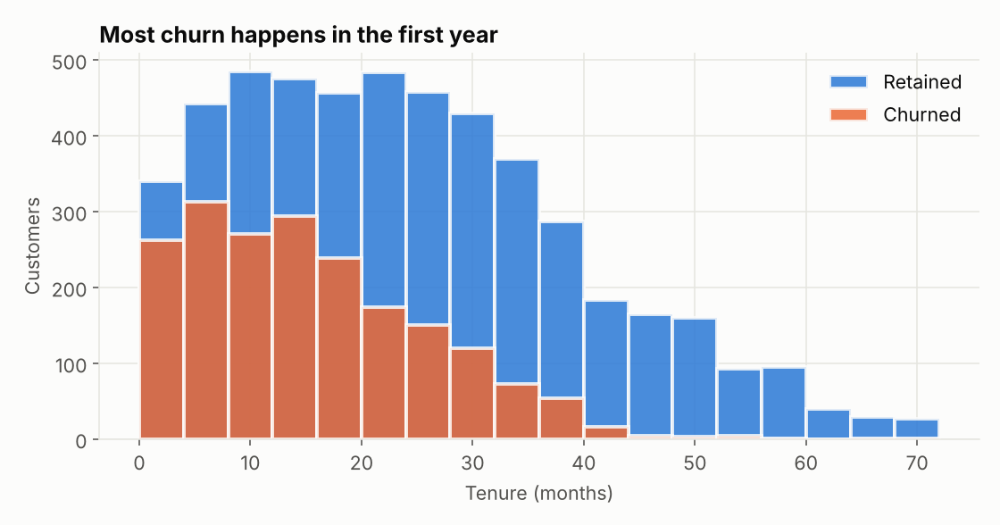
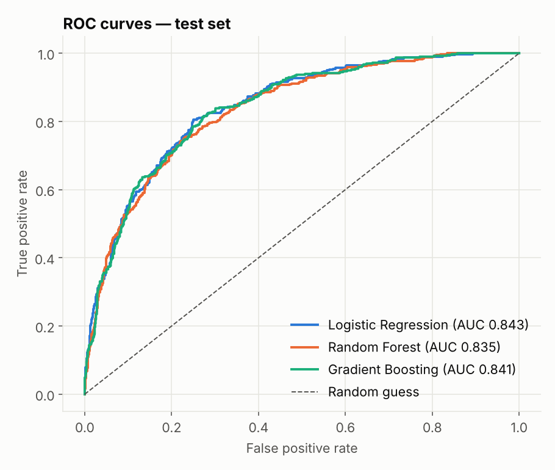
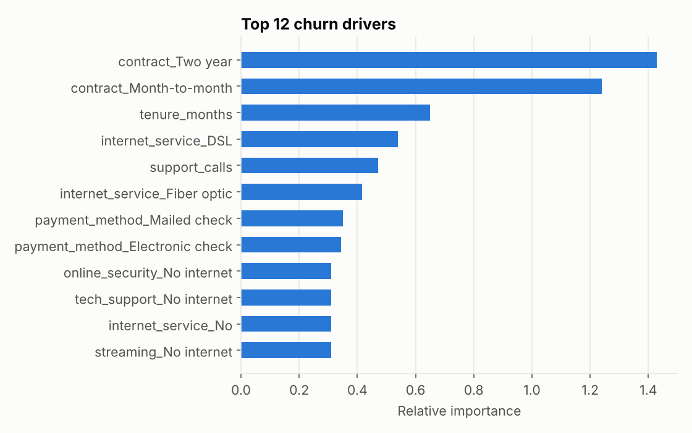
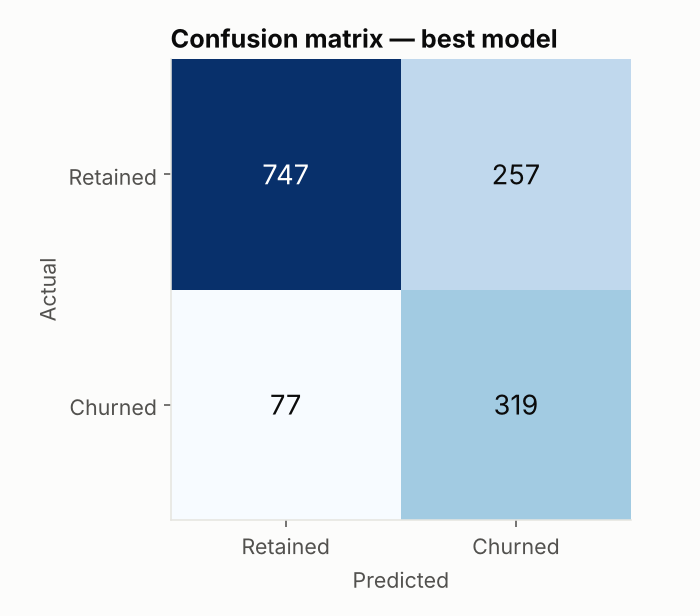

<div align="center">

# 📉 ChurnGuard

### End-to-end Customer Churn Prediction — from raw data to an interactive dashboard


[](https://YOUR-CHURNGUARD-APP.streamlit.app)



</div>

---

## 🎯 Business Problem

Acquiring a new telecom customer costs **5–7× more** than keeping an existing one. ChurnGuard predicts **which customers are likely to leave**, explains **why**, and suggests **retention actions** — so the business can intervene before revenue walks out the door.

## 🚀 Highlights

- 🧪 **Reproducible dataset** — a 7,000-customer synthetic telecom dataset generated with realistic churn drivers (no downloads)
- 🛠️ **Feature engineering** — tenure buckets, average spend, service-bundle count
- 🤖 **3 models compared** with 5-fold stratified cross-validation: Logistic Regression, Random Forest, Gradient Boosting
- 🎚️ **Threshold tuning** — optimises F1 instead of using the naive 0.5 cut-off (churn is imbalanced)
- 📊 **Automated reporting** — every training run regenerates charts and `metrics.json`
- 🖥️ **Streamlit dashboard** — single-customer prediction, batch CSV scoring with download, and model insights
- ✅ **Unit tests** with pytest

## 🖥️ Dashboard

| Batch scoring | Model insights |
|:---:|:---:|
|  |  |
| Upload a CSV, get every customer ranked by churn risk, download results | ROC curves, churn drivers, confusion matrix and EDA charts |

## 📈 Results

| Model | CV ROC-AUC | Test ROC-AUC | Precision | Recall | F1 |
|-------|-----------:|-------------:|----------:|-------:|---:|
| **Logistic Regression** ⭐ | **0.845 ± 0.008** | **0.843** | 0.566 | 0.763 | 0.650 |
| Gradient Boosting | 0.838 ± 0.010 | 0.841 | 0.681 | 0.546 | 0.606 |
| Random Forest | 0.832 ± 0.010 | 0.835 | 0.561 | 0.755 | 0.644 |

After tuning the decision threshold to **0.46**, the selected model catches **80.6 % of churners** (recall) with an F1 of **0.656**.

> 💡 **Insight:** the simple, interpretable Logistic Regression matched or beat the tree ensembles — a good reminder that complex models aren't automatically better.

## 🔍 Key Findings

<p align="center"></p>

- **Month-to-month** customers churn at **~43 %** vs **~5 %** on two-year contracts
- **Fibre-optic** users churn more than twice as often as DSL users
- **Electronic-check** payers are the riskiest payment group
- Churn is concentrated in the **first 12 months** of tenure

<p align="center">
  
  
</p>
<p align="center">
  
  
</p>

## 📁 Project Structure

```
churnguard/
├── app.py                    # Streamlit dashboard
├── src/
│   ├── data_generator.py     # Synthetic dataset generator
│   ├── features.py           # Feature engineering + preprocessing pipeline
│   └── train.py              # Training, CV, threshold tuning, charts, model export
├── data/customers.csv        # Generated dataset
├── models/churn_model.joblib # Saved best pipeline + threshold
├── reports/
│   ├── metrics.json
│   └── figures/              # Auto-generated charts
└── tests/test_churn.py
```

## ⚡ Quick Start

```bash
git clone https://github.com/umeshgoingtohieng/churnguard.git
cd churnguard
python -m venv venv && source venv/bin/activate   # Windows: venv\Scripts\activate
pip install -r requirements.txt

python -m src.data_generator     # 1. create the dataset
python -m src.train              # 2. train, evaluate, save model + charts
streamlit run app.py             # 3. launch the dashboard
```

Run tests with `pytest -v`.

## 🧠 ML Pipeline

```
customers.csv ─▶ add_features() ─▶ ColumnTransformer ─▶ Model ─▶ threshold tuning ─▶ churn_model.joblib
                 (tenure_group,     (StandardScaler +    (LR / RF / GB,
                  avg spend,         OneHotEncoder)       5-fold CV)
                  services_count)
```

Everything — preprocessing and model — lives in one scikit-learn `Pipeline`, so the exact same transformations are applied at training time and inside the dashboard (no training/serving skew).

## 🛣️ Roadmap

- [ ] SHAP explanations per customer
- [ ] Hyperparameter search with Optuna
- [ ] FastAPI endpoint + Docker
- [ ] Customer lifetime value to prioritise retention spend

## 📜 License

[MIT](LICENSE)

---

<div align="center">Made with ❤️ by <a href="https://github.com/umeshgoingtohieng">Umesh Meena</a> · ⭐ Star if you found it useful!</div>
